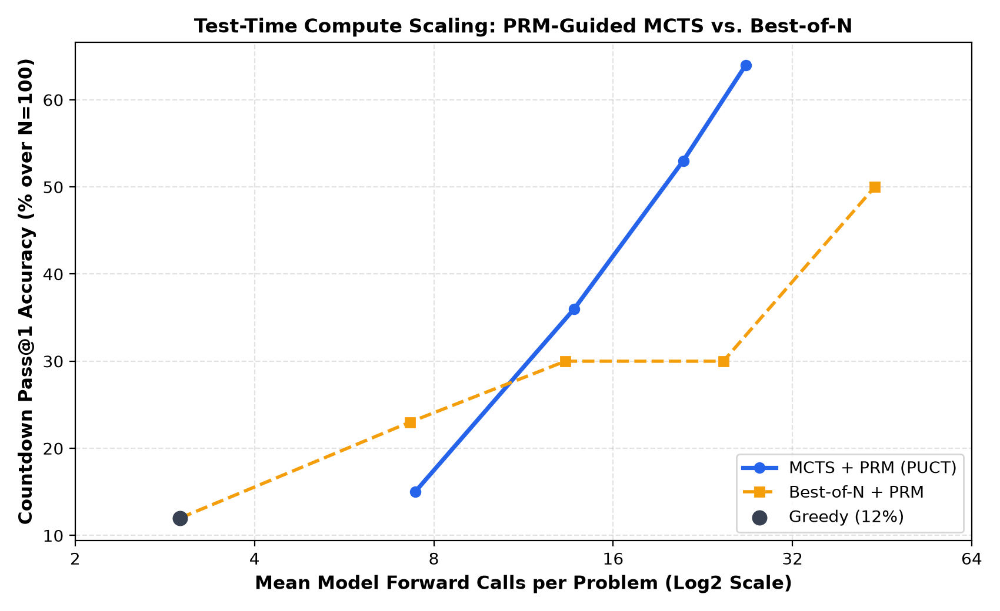

# MCTS Reasoning Engine

[](https://github.com/ajvisuni/mcts-reasoning-engine/actions/workflows/ci.yml)
[](https://github.com/ajvisuni/mcts-reasoning-engine/releases/latest)
[](LICENSE)

**Test-Time Compute Scaling with Process Reward Models (PRM) and PUCT Search**



I built this project to test how much inference-time search improves multi-step reasoning on a small language model without changing its weights.

Standard autoregressive models generate tokens left-to-right: if they make a bad arithmetic move on step one, they can't backtrack. Here, I paired a 1.83M-parameter (`1,833,025`) dual-head causal Transformer with a PUCT Monte Carlo Tree Search engine on the **Countdown Numbers Game** (combining 4 integers with `+`, `-`, `*`, `/` to hit a target). Instead of committing to a single greedy rollout, the engine uses extra compute at inference time to explore intermediate states, score partial paths with a Process Reward Model (PRM), and back out of dead ends.

---

## Benchmark Results

All three inference strategies were evaluated using the same 1.83M-parameter checkpoint ([`v0.2.0`](https://github.com/ajvisuni/mcts-reasoning-engine/releases/tag/v0.2.0)) on **100 unique held-out test instances** (`seed=42`). Compute is measured directly in **model forward calls** (`expand_candidates` policy passes + `evaluate_prm` value passes) per problem, and both Best-of-N and MCTS use the same exact symbolic verifier to stop early once a valid target match is reached.

**Greedy (Single Pass):** `12.0%` (`12/100`) | Mean calls: `3.0` (`3.0` expand, `0.0` PRM)

**Best-of-N + PRM**

| Rollouts (`N`) | Expand Calls | PRM Calls | Total Calls | Solved | Pass@1 (%) |
| :--- | :---: | :---: | :---: | :---: | :---: |
| **N = 1** | 3.0 | 0.0 | 3.0 | 12/100 | 12.0% |
| **N = 2** | 5.6 | 1.6 | 7.3 | 23/100 | 23.0% |
| **N = 4** | 10.2 | 3.1 | 13.3 | 30/100 | 30.0% |
| **N = 8** | 18.6 | 5.9 | 24.5 | 30/100 | 30.0% |
| **N = 16** | 33.4 | 10.6 | 44.0 | 50/100 | 50.0% |

**MCTS + PRM (`c_puct=1.4`, `branch_factor=4`)**

| Simulations (`S`) | Expand Calls | PRM Calls | Total Calls | Solved | Pass@1 (%) |
| :--- | :---: | :---: | :---: | :---: | :---: |
| **S = 4** | 3.7 | 3.7 | 7.4 | 15/100 | 15.0% |
| **S = 8** | 6.9 | 6.9 | 13.8 | 36/100 | 36.0% |
| **S = 16** | 10.5 | 10.5 | 21.0 | 53/100 | 53.0% |
| **S = 32** | 13.4 | 13.4 | 26.7 | **64/100** | **64.0%** |

### What stood out in the runs
* **Compute efficiency over Best-of-N:** At `S = 16` (`21.0` mean forward calls), MCTS reaches **53.0% Pass@1 (53/100)**, beating `N = 16` Best-of-N (**50.0%, 50/100**) while using less than half the forward calls (`44.0`).
* **Sub-linear compute growth:** At `S = 32`, MCTS hits **64.0% Pass@1 (64/100)** in **26.7** mean calls, more than 5x single-pass Greedy (**12.0%, 12/100**). Because search stops as soon as the verifier confirms a solved state, easy puzzles finish quickly while harder ones get the remaining budget.

---

## Example Trace: Escaping a Dead End

On `TARGET:24 | [8,7,3,2]`, greedy decoding gets the opening move right (`8+7=15`), then picks `15+3=18` and gets stuck at `[20]`. MCTS checks `15+3=18` and `3-2=1` first, backs up `0.00` from their dead-end leaves, and pivots to `15-3=12 -> 12*2=24`:

**Greedy (`3` forward calls):**
```text
8+7=15 | [15,3,2] -> 15+3=18 | [18,2] -> 18+2=20 | [20] <EOS>  [FAILED]
```

**MCTS + PRM (`S = 16`, key branches under `8+7=15` shown):**
```text
ROOT: TARGET:24 | [8,7,3,2] ->  [Visits N=14]
├── 8+7=15 | [15,3,2] ->  | Prior P=0.27 | PRM V=0.87 | Q=0.51 (N=5)  [EXPLORED]
│   ├── 15+3=18 | [18,2] ->  | Prior P=0.26 | PRM V=0.70 | Q=0.35 (N=2)  [EXPLORED]
│   │   └── 18+2=20 | [20] <EOS>  | Prior P=0.37 | PRM V=0.00 | Q=0.00 (N=1)  [DEAD-END]
│   ├── 3-2=1 | [15,1] ->  | Prior P=0.26 | PRM V=0.55 | Q=0.00 (N=1)  [EXPLORED]
│   │   └── 15-1=14 | [14] <EOS>  | Prior P=0.35 | PRM V=0.00 | Q=0.00 (N=1)  [DEAD-END]
│   └── 15-3=12 | [12,2] ->  | Prior P=0.25 | PRM V=0.69 | Q=1.00 (N=1)  [EXPLORED]
│       └── 12*2=24 | [24] <EOS>  | Prior P=0.55 | PRM V=1.00 | Q=1.00 (N=1)  [SOLVED]
├── 8-3=5 | [7,5,2] ->   | Prior P=0.24 | PRM V=0.46 | Q=0.24 (N=3)  [EXPLORED]
├── 8+3=11 | [11,7,2] -> | Prior P=0.24 | PRM V=0.52 | Q=0.21 (N=3)  [EXPLORED]
└── 8*7=56 | [56,3,2] -> | Prior P=0.24 | PRM V=0.73 | Q=0.23 (N=3)  [EXPLORED]
```

There's also a full Mermaid search graph exported from a held-out test puzzle in [`examples/backtrack_trace.md`](examples/backtrack_trace.md).

---

## How It Works

```text
State s_t (e.g. TARGET:24 | [8,7,3,2] ->)
   │
   ▼
Dual-Head Causal Transformer (4 Layers, d_model=192, 1.83M Params)
   ├── Policy Head π(a | s_t)  ──► Candidate Step Priors P(s, a)
   └── Process Reward Head v(s_t) ──► Step Solvability Score ∈ [0, 1]
   │
   ▼
PUCT Monte Carlo Tree Search (Select ──► Expand & Evaluate ──► Backpropagate)
   │
   ▼
Exact Symbolic Step Verifier ──► Verified Solution (or Backpropagate Dead End)
```

1. **Environment & Exact Oracle (`src/env.py`):** States are plain text strings. During dataset generation, a recursive DFS solver (`solve_countdown`) labels states along the oracle solution as positive (`1.0`) and samples unsolvable depth-1 and depth-2 moves as negative (`0.0`) so the PRM learns to spot traps early.
2. **Dual-Head Transformer (`src/model.py`):** A 4-layer causal Transformer (`vocab_size=26`, `d_model=192`, `1,833,025` parameters) trained jointly on non-padded next-token cross-entropy and final-token binary cross-entropy (`prm_head`). At inference time, valid candidate next steps are scored in one batched forward pass to get length-normalized priors `P(s, a)`.
3. **PUCT Tree Search (`src/mcts.py`):** Pure-Python MCTS kept separate from PyTorch. Each simulation runs one standard PUCT pass (`select` -> `expand_and_evaluate` -> `backpropagate`), picking the child action `a` maximizing:

```text
PUCT(s, a) = Q(s, a) + c_puct * P(s, a) * sqrt(N(s)) / (1 + N(s, a))
```

where `Q(s, a) = W(s, a) / N(s, a)` is the mean backed-up PRM score and `P(s, a)` is the policy prior.

---

## Project Structure

```text
mcts-reasoning-engine/
├── .github/workflows/ci.yml
├── .gitignore
├── CONTRIBUTING.md
├── LICENSE
├── pyproject.toml
├── requirements.txt
├── app.py                     # Gradio UI for comparing Greedy vs. MCTS
├── assets/
│   └── scaling_law.png
├── examples/
│   └── backtrack_trace.md
├── scripts/
│   └── benchmark.py           # Forward-call sweep and plot generation
├── src/
│   ├── env.py                 # Countdown generator, step verifier, DFS oracle
│   ├── tokenizer.py           # 26-token vocabulary
│   ├── model.py               # Dual-head Transformer and batched inference
│   ├── mcts.py                # Pure-Python PUCT search and tree exporters
│   ├── baselines.py           # Greedy and Best-of-N PRM baselines
│   └── train.py               # Joint Policy + PRM training script
└── tests/
    ├── test_env.py
    ├── test_model.py
    └── test_mcts.py
```

---

## Running It Locally

Clone the repo, set up a virtual environment (`.venv\Scripts\activate` on Windows), install dependencies, and run the tests:

```bash
git clone https://github.com/ajvisuni/mcts-reasoning-engine.git
cd mcts-reasoning-engine
python -m venv .venv
source .venv/bin/activate
pip install -r requirements.txt
pytest -v
```

To skip training, download `checkpoint.pt` from the [`v0.2.0` release](https://github.com/ajvisuni/mcts-reasoning-engine/releases/tag/v0.2.0) and put it at `data/checkpoint.pt`. If you'd rather train the 1.83M model from scratch:

```bash
python -m src.train --problems 4000 --epochs 10 --batch-size 128
```

Once the checkpoint is in place, run the scaling benchmark or start the Gradio viewer at `http://127.0.0.1:7860`:

```bash
python scripts/benchmark.py --num-test 100
python app.py
```

---

## Contributing & License

See [`CONTRIBUTING.md`](CONTRIBUTING.md) for code standards and test requirements before opening a PR. Released under the [MIT License](LICENSE).
