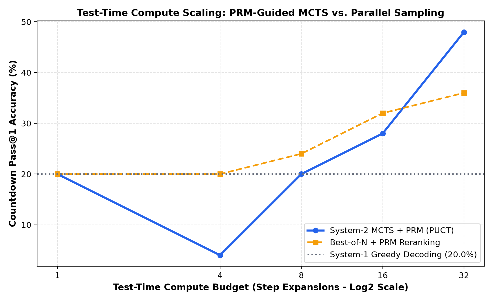

# MCTS Reasoning Engine

**Test-Time Compute Scaling with Process Reward Models (PRM) and PUCT Search**



I built this project to test how inference-time search improves multi-step reasoning on a small language model without changing its weights.

Standard autoregressive models generate tokens left-to-right: if they make a poor arithmetic choice on step one, they cannot go back. Here, I have paired a 1.7M-parameter dual-head causal Transformer with a PUCT Monte Carlo Tree Search engine on the **Countdown Numbers Game** (combining 4 integers with `+`, `-`, `*`, `/` to hit a target). Instead of trusting a single greedy like (faster) rollout, the model uses extra compute at inference time to explore intermediate states, score partial deductions with a Process Reward Model (PRM), and backtracking out of dead ends.

---

## Benchmark Results

I evaluated three inference strategies using the exact same 1.7M-parameter checkpoint across compute budgets `C ∈ {1, 4, 8, 16, 32}` (measured in step expansions) on held-out test instances:

| Compute Budget (`C`) | Greedy (`N = 1`) | Best-of-`N` + PRM | MCTS + PRM | Gain over Greedy |
| :--- | :---: | :---: | :---: | :---: |
| **`C = 1`** | 20.0% | 20.0% | 20.0% | `0.0%` |
| **`C = 4`** | 20.0% | 20.0% | 4.0% | `-16.0%` |
| **`C = 8`** | 20.0% | 24.0% | 20.0% | `0.0%` |
| **`C = 16`** | 20.0% | 32.0% | 28.0% | `+8.0%` |
| **`C = 32`** | 20.0% | 36.0% | **48.0%** | **`+28.0%`** |

### What stood out in the runs
* **Why MCTS dips at `C = 4`:** A 4-number Countdown problem takes 3 steps to finish. At tiny budgets (`C ≤ 8`), the PUCT exploration term spreads visits across sibling branches at depth 1 and 2 before reaching terminal leaves, so parallel sampling (Best-of-`N`) leads early on.
* **The crossover at `C = 32`:** Once the tree saturates depth 3, MCTS stops wasting compute on low-PRM branches and focuses on promising subtrees—reaching **48.0% Pass@1**, outperforming Best-of-`N` (36.0%) by 12 points and more than doubling single-pass Greedy decoding (20.0%).

---

## Example Trace: Escaping a Dead End

On `TARGET:24 | [8,7,3,2] ->`, greedy decoding grabs the highest-probability first move (`8+3=11`) and ends up stuck at `[29]`. MCTS tries that branch first, sees the PRM scores drop to `0.00` on the leaf states, and backtracks to `8+7=15` to find the valid path:

```text
Greedy (C=1):
  8+3=11 | [11,7,2] -> 11*2=22 | [22,7] -> 22+7=29 | [29] <EOS>   [FAILED]

MCTS + PRM (C=16):
  ROOT: TARGET:24 | [8,7,3,2] ->  [Visits N=9]
  ├── 8+3=11 | [11,7,2] ->  |  Prior P=0.26 | PRM V=0.99 | Q=0.50 (N=2) [EXPLORED]
  │   └── 7*2=14 | [14,11] ->  |  Prior P=0.25 | PRM V=0.99 | Q=0.50 (N=2)
  │       └── 14+11=25 | [25] <EOS>  |  Prior P=0.54 | PRM V=0.00 | Q=0.00 [DEAD-END]
  └── 8+7=15 | [15,3,2] ->  |  Prior P=0.26 | PRM V=0.22 | Q=0.61 (N=2)
      └── 15-3=12 | [12,2] ->  |  Prior P=0.26 | PRM V=0.23 | Q=0.61 (N=2)
          └── 12*2=24 | [24] <EOS>  |  Prior P=0.43 | PRM V=1.00 | Q=1.00 [SOLVED]
```

You can inspect a full Mermaid search graph exported from test instance `TARGET:65 | [20,7,5,1] ->` in [`examples/backtrack_trace.md`](examples/backtrack_trace.md).

---

## How It Works

```text
State s_t (e.g. TARGET:24 | [8,7,3,2] ->)
   │
   ▼
Dual-Head Causal Transformer (4 Layers, d_model=192, ~1.7M Params)
   ├──► Policy Head π(a | s_t)           ──► Candidate Step Priors P(s, a)
   └──► Process Reward Head V(s_t)       ──► Step Solvability Score ∈ [0, 1]
                  │
                  ▼
      PUCT Monte Carlo Tree Search
      (Select → Expand → Backpropagate)
                  │
                  ▼
       Exact Symbolic Step Verifier ──► Verified Solution (or Backtrack on Dead End)
```

1. **Environment & Exact Oracle (`src/env.py`):** Represents states as plain text strings. During dataset generation, a recursive DFS solver (`solve_countdown`) labels intermediate states as either solvable (`1.0`) or dead ends (`0.0`) so the PRM learns to spot traps early.
2. **Dual-Head Transformer (`src/model.py`):** A 4-layer causal Transformer (`vocab_size=28`, `d_model=192`) trained jointly on next-token cross-entropy and step-boundary binary cross-entropy (`prm_head`). At inference time, candidate next steps are scored in one batched forward pass to produce length-normalized priors `P(s, a)`.
3. **PUCT Tree Search (`src/mcts.py`):** A pure-Python MCTS implementation kept separate from PyTorch. At each node `s`, it selects child action `a` maximizing:

```text
PUCT(s, a) = Q(s, a) + c_puct * P(s, a) * sqrt(N(s)) / (1 + N(s, a))
```

where `Q(s, a) = W(s, a) / N(s, a)` is the average backed-up PRM score and `P(s, a)` is the policy prior.

---

## Project Structure

```text
mcts-reasoning-engine/
├── app.py                  # Gradio web UI to compare Greedy vs. MCTS live
├── CONTRIBUTING.md         # Code standards, invariants, and PR rules
├── requirements.txt        # Dependencies
├── assets/
│   └── scaling_law.png     # Pass@1 vs. Log2 compute budget plot
├── examples/
│   └── backtrack_trace.md  # Exported Mermaid tree from a test run
├── scripts/
│   └── benchmark.py        # Compute sweep and plot generation
├── src/
│   ├── env.py              # Countdown generator, step verifier, & DFS oracle
│   ├── tokenizer.py        # 28-token atomic/character vocabulary
│   ├── model.py            # Dual-Head Transformer & batched Policy/PRM interface
│   ├── mcts.py             # Pure-Python PUCT MCTS engine & tree exporters
│   ├── baselines.py        # Greedy & Best-of-N PRM-reranked baselines
│   └── train.py            # Joint Policy + PRM training script
└── tests/
    ├── test_env.py         # Oracle & arithmetic verification tests
    ├── test_model.py       # Causal mask non-leakage & gradient tests
    └── test_mcts.py        # PUCT math, backpropagation, & trap-escape tests
```

---

## Running It Locally

```bash
git clone https://github.com/ajvisuni/mcts-reasoning-engine.git
cd mcts-reasoning-engine
python -m venv .venv
source .venv/bin/activate
pip install -r requirements.txt

pytest -v
python -m src.train --problems 4000 --epochs 10 --batch-size 128
python scripts/benchmark.py --num-test 25
python app.py
```

Running `app.py` opens a local Gradio interface at `http://127.0.0.1:7860` where you can plug in custom 4-number puzzles, adjust the simulation budget or `c_puct`, and inspect the search tree.

---

## Contributing & License

If you want to contribute, please read [`CONTRIBUTING.md`](CONTRIBUTING.md) first for the architectural rules and testing requirements.

Licensed under the MIT License. See [`LICENSE`](LICENSE).
